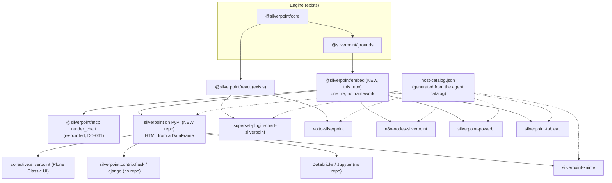

# feature-007 — silverpoint in BI tools and flows

| Field | Value |
|---|---|
| **Status** | `APPROVED` and **folded into `specs/` 2026-11-21** (T-329) — every gate approved 2026-11-20 (user decision), decisions D1..D12 as recommended; the PoC (step 11a, T-290) in [`poc.md`](poc.md); OQ-H1..H4 resolved (TD delta §7). **Phase 11 implemented** 2026-11-20/21 on `feat/silverpoint-0.11` (T-290..T-329, ledger in [`plan-and-tasks.md`](plan-and-tasks.md)); deviations 1–9 accepted by the user 2026-11-21 and folded as built. Not released |
| **Target release** | `0.11.0` (changeset `minor` from 0.10.x), decision D1, confirmed by the user 2026-11-21. The line stays on `0.x`; `1.0.0` stays parked |
| **Requirements** | REQ-629..REQ-668 (§6.16), 40 (39 MUST, 1 SHOULD) |
| **Design decisions** | DD-061..DD-072 (DD-062 records the PoC outcome) |
| **Invariants** | I-53..I-60 |
| **Diagnostics** | `SP030`, `SP031` |
| **Tasks** | T-290..T-329 (Phase 11, steps 11a..11h; 11a is the PoC). Satellite work is Phase 12, tracked per repository |
| **Constitution** | Amendment v1.11 → v1.12 ([`constitution-amendment.md`](constitution-amendment.md)): scope, Art. 2, Art. 3, a "Host targets" stack row |
| **Branch** | `spec/feature-007-bi-hosts` (specs); implementation on `feat/silverpoint-0.11` |
| **New package here** | `@silverpoint/embed` (tenth of the `fixed` group) |
| **New repositories** | Eight, listed in [`repositories/README.md`](repositories/README.md), each with a spec pack to copy into it |
| **Sibling repositories** | `reflex-silverpoint-react` (follows the `0.11` line, no API change), `silverpoint_web` (a hosts page) — [`sibling-prompts.md`](sibling-prompts.md) |

## The idea in one diagram

The user's diagram (2026-11-20) is the source; two things differ from it and are argued in
[`research.md`](research.md) §5: the Node render the n8n node uses is `@silverpoint/embed`'s DOM-free
entry rather than the MCP's private function (one path, DD-061), and the manifests are not generated
in this repository — this repository publishes a neutral **host catalog** and each satellite projects
it into its tool's own format (DD-066, DD-068).

## Reading order and approval gates

| Gate | Artifact | Decides | Approved |
|---|---|---|---|
| 0 | [`research.md`](research.md) | What exists to build on; each host's constraints, measured or cited; which repositories; decisions D1..D12 | ✅ 2026-11-20 |
| 1 | [`prd-delta.md`](prd-delta.md) | The what: scope, personas, REQ-629..668 | ✅ 2026-11-20 |
| 2 | [`api-delta.md`](api-delta.md) | The contract: `@silverpoint/embed`, `ChartSpec`, the client, the standalone file, the host catalog, `specFromTable`, the MCP changes | ✅ 2026-11-20 |
| PoC | [`poc.md`](poc.md) (Phase 11a, T-290) | The standalone file's size and format; that it runs under a strict CSP, in a sandboxed iframe and in a notebook output (DD-062) | ✅ 2026-11-20 — Chromium measured; Firefox and WebKit carried to T-324 |
| 3 | [`technical-design-delta.md`](technical-design-delta.md) + [`data-model-delta.md`](data-model-delta.md) | The how: DD-061..072; the shapes | ✅ 2026-11-20 — DD-062 filled from the PoC, DD-070 amended (F-P1), OQ-H1..H4 resolved |
| 4 | [`plan-and-tasks.md`](plan-and-tasks.md) | Phase 11 steps and tasks, T-290..T-329; Phase 12 waves | ✅ 2026-11-20 |
| — | [`analyze.md`](analyze.md) | Coverage 40/40; findings A-01..A-10, re-run after the PoC | ✅ 2026-11-20 |
| — | [`constitution-amendment.md`](constitution-amendment.md) | Scope line; Art. 2 and Art. 3 for `@silverpoint/embed`; host targets | ✅ 2026-11-20 (in force when folded, T-329) |
| — | [`repositories/README.md`](repositories/README.md) | The eight repositories: names, descriptions, licences, registries, order of creation | ✅ 2026-11-20 |

Supporting: [`first-publish.md`](first-publish.md) (reserving `@silverpoint/embed` on npm),
[`sibling-prompts.md`](sibling-prompts.md), [`tdd-plan.md`](tdd-plan.md) (the order in which tests are written,
what makes each red and its oracle, for Phase 11 and the eight hosts).

The working order of feature-006 applies: discovery → PRD → API → TD → **PoC** → data model → plan →
tasks → analyze → implementation, with a review stop after discovery, after the API and after the PoC.
Because every artifact was drafted before any gate was reviewed, a decision changed at gate 0 or 1
is expected to ripple: [`analyze.md`](analyze.md) §3 lists which artifacts each decision touches.

## What this repository does and does not take on

- **Here:** `@silverpoint/embed`, the host catalog, the conformance kit, the MCP and skill updates, the
  docs, and the specifications of the satellites.
- **Not here:** any tool's SDK, manifest format or packaging. A host integration lives in its own
  repository, pins a silverpoint release line, vendors the standalone file or depends on
  `@silverpoint/react`, and proves itself with the conformance kit (DD-068).
- **Out:** Databricks AI/BI dashboards, whose custom visualizations accept a Vega-Lite specification
  and nothing else (research §4.6, DD-072).
