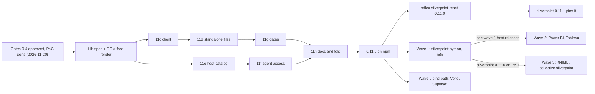

# TDD implementation plan — feature-007, Phase 11 (this repository) and Phase 12 (the hosts)

| Field | Value |
|---|---|
| **Status** | `APPROVED` — 2026-11-20 with every gate (user decision). Written after a full read of `feature-007-bi-hosts/`, the eight new repositories and `reflex-silverpoint-react` at `f904ea2`; updated the same day with the gate decisions and the PoC ([`poc.md`](poc.md)). Phase 11 starts at step 11b |
| **Relation to the ledger** | [`plan-and-tasks.md`](plan-and-tasks.md) stays the ledger (ids, boxes, dependencies). This file fixes **the order in which tests are written, what makes each one red, and what oracle it is checked against**. It adds no requirement and changes no task id |
| **Inputs** | `README.md`, `research.md` (D1..D12), `prd-delta.md` (REQ-629..668), `api-delta.md`, `technical-design-delta.md` (DD-061..072), `data-model-delta.md` (I-53..I-60), `analyze.md` (A-01..A-10), `repositories/*.md`, `sibling-prompts.md`; the workspace's test tooling (`vitest.config.ts`, `tools/visual-gate`, `tools/svg-normalizer`, `tools/agent-catalog`, `tools/lint-rules`, `e2e/`, `.size-limit.json`, `.github/workflows/ci.yml`) |

## 0. Findings of the review — to settle before the first red test

| ID | Finding | Consequence for the plan |
|---|---|---|
| F-01 | **No gate is approved** (README §Reading order). Art. 9 forbids implementation of a medium feature without an approved spec | Order: gates 0, 1, 2 → PoC (11a) → gates 3, 4 → 11b. The PoC is measurement, not TDD; its numbers become red tests (11d). **Resolved 2026-11-20:** every gate approved, the PoC done |
| F-02 | `changes/feature-007-bi-hosts/` is **untracked** on `develop` and `CLAUDE.md` is modified but uncommitted; the branch `spec/feature-007-bi-hosts` named in the README does not exist | Commit the drafts on that branch before the gate review, so the review has a diff and the ledger has a base. **Resolved 2026-11-20:** the branch exists and the folder is staged on it; the user commits |
| F-03 | The eight repositories **already exist** (LICENSE + README, `main` only, no `develop`, no `specs/`). `repositories/README.md` §4 proposed creating them by waves; §5 steps 2–3 (spec pack, topics) are pending in all eight | Harmless while empty. The WIP limit of research R5 (≤ 3 repositories under active work) is applied to *opening work*, not to their existence (§5). **2026-11-20:** a local `develop` branch exists in all eight (not pushed) |
| F-04 | Licences match §2: seven MIT, `collective.silverpoint` carries the GPL v2 text. The text alone does not say **"-only"** | PLC iteration 0 adds a red test: `pyproject.toml` declares `license = "GPL-2.0-only"`. `silverpoint-knime` stays MIT pending KN-OQ-1 |
| F-05 | **Oracle independence.** Three artefacts are generated by the code they verify: the `renderToHTML` goldens (T-295), `host-catalog.json` (T-313) and `conformance.json` (T-325). A golden produced by the implementation cannot be red, and I-60 is tautological inside this repository (the kit hashes the embed's own output) | Each gets an independent oracle first (§1.4) and its golden is frozen only after review (approval test). Add **I-60b** to T-325: every conformance case's SVG parses to the canonical render's tree — this anchors the hashes to I-53 |
| F-06 | The interaction the client ports (DD-064) is specified today only as three adapter suites: `packages/react/test/interaction.test.tsx`, `packages/vue/test/interaction.test.ts`, `packages/angular/test/interaction.test.ts` | Before T-300, a **characterisation refactor** (green → green): extract the cases into a shared table in `tools/testing`, consumed by the three adapters. The embed's tests are then red against the same table |
| F-07 | T-318 (re-point `render_chart`) is a **refactor**, not a feature: REQ-660 says the output does not change | No behavioural red test. Safety net: the REQ-567 gate and the MCP contract tests, recorded green before and after. Red only for structure: `check-deps` expects `mcp → embed` and no `packages/mcp/src/recipes.ts` |
| F-08 | There is no property-testing library in the workspace and the TD allowlist is closed (Art. 8) | I-54's property test uses the core's seeded PRNG, as the existing property tests do (`packages/core/test/prng-dates.test.ts`); no `fast-check` |
| F-09 | "Mutation-check any test written after the code" (CLAUDE.md) is manual | Each step lists the one deliberate mutation that must turn its outer test red; the result is noted in the ledger. No Stryker dependency |
| F-10 | Wave-0 hosts (Volto, Superset) can do their PoC on `@silverpoint/react` 0.10, but their bind path needs `specFromTable` (0.11) | Their bind tests are written against a **local tarball** of `packages/embed` (`pnpm pack`) on their `develop` branch only; H-2's pin moves to npm `0.11.0` before any release (§4.3) |
| F-11 | `reflex-silverpoint-react` needs no API change (sibling-prompts) | One red test first (`tests/test_v011.py`), then the line bump; then this repository pins its export in `0.11.1` (delta-017) |
| F-12 | DD-062 is open; T-306, T-309 and T-311 depend on it (A-01) | Their budget tests are written **with the PoC's numbers**, never with placeholders. **Resolved 2026-11-20:** 140 / 220 kB gzip, own code 12 / 8 kB (DD-062) |
| F-13 | OQ-H3 (orbit long-form binding) and OQ-H4 (label localisation) change red tests in 11e (orbit's `binding: none` fixture) and in Volto/Power BI i18n | **Resolved at gate 3:** orbit stays `binding: 'none'`; hosts translate, keyed on the catalog's stable ids (TD delta §7) |

## 1. The protocol

### 1.1 Double loop

- **Outer loop — one acceptance test per step**, written first, red at the start of the step and
  green only at its exit. It is always an invariant or a gate the specs already name (I-53, I-56,
  I-57, I-59, I-60, REQ-664/665), so the step's "done" is a test, not a judgement.
- **Inner loop — red → green → refactor per task**, inside the step, citing the task's REQ.

### 1.2 The cycle for every task

1. **Red.** Write the tests, named in the repository's convention (`'REQ-631 · …'`). Run them and
   keep the output. The failure must be an **assertion**, not a missing module: scaffold stubs that
   throw `new Error('not implemented')` so the first red is meaningful.
2. **Green.** The least code that passes. No code without a red test asking for it.
3. **Refactor.** With the whole project green: `pnpm lint` (eslint, `check-deps`, `spec-check`).
4. **Mutation check.** Break one line the new test covers; see it red; revert. One line in the ledger.
5. **Evidence (H-8).** The PR description carries the red output and the green output of the step's
   outer test — the rendered tree, markup or manifest, not only the verdict.
6. **Never edit a test to make it pass.** A test changes only with an approved delta.

### 1.3 Test levels and where they live

| Level | Location | Runner / environment | Used by |
|---|---|---|---|
| Unit, DOM-free | `packages/embed/test/*.test.ts` — new vitest project `embed` | vitest, `node` | 11b, 11e, 11d (Node half) |
| DOM | `packages/embed/test/dom/*.test.ts` — new project `embed-dom` | vitest, `happy-dom` (already installed, 20.14) | 11c |
| Generator | `tools/agent-catalog/*.test.ts` | vitest | T-293, T-313, T-319, T-321 |
| Lint rule | `tools/lint-rules/no-network.test.ts` | vitest | T-310 |
| Gate | `tools/visual-gate/embed-*.test.ts` (+ `.real.test.ts` in the pinned image) | vitest + pinned Chromium | outer 11b, T-322, T-323 |
| E2E | `e2e/embed.spec.ts`, job `browser-embed` | Playwright, three engines | T-324, T-326 |
| Contract | `packages/mcp/test/*` | vitest | T-318..T-320 |
| Bundle | `.size-limit.json`, `check-deps`, REQ-444 gate | size-limit, node | T-311, T-312 |

### 1.4 Oracles — what each test compares against, and why it is independent

| Under test | Oracle | Independent because |
|---|---|---|
| `renderToSVG`, `mount` | Canonical render via `tools/visual-gate/canonical.ts`, compared as **parsed trees** with `tools/svg-normalizer` (never normalised strings) | It exists today and the adapters already pass it |
| `renderToHTML` | The markup contract (API delta §5) as structural assertions; then goldens frozen after review | The contract is written by hand; the golden is approved, not generated into green |
| `validateSpec` | One hand-written case per `SpecError` kind + totality over seeded arbitrary JSON | Expected errors come from the API delta, not from the code |
| Interaction | The adapters' shared case table (F-06) | Already proven on three frameworks |
| Error figure (REQ-668) | The deck fence's error figure (`packages/marp/src/fence/render.ts`, REQ-591) | Existing, released behaviour |
| JSON-for-script escaping | `packages/marp/test/hostile.test.ts`'s corpus, extended | Existing corpus |
| Host catalog | Hand-written expectations for four representative charts + I-58 over all | Not generated by the projection |
| Reshapes | Hand-computed outputs in `fixtures/embed/tables` | Written before the code |
| Conformance hashes | I-60b: each case's tree equals the canonical render | Anchors the hashes to I-53 (F-05) |
| Standalone budgets | The PoC's measurements (DD-062) | Measured, not chosen |

## 2. Phase 11 — this repository, step by step

### Before 11a: the gates — done

Every gate approved 2026-11-20 (user decision); D1..D12 as recommended, including the vitest
projects `embed` and `embed-dom` in the root `vitest.config.ts` (T-291). The folder is staged on
`spec/feature-007-bi-hosts` (F-02).

### 11a — PoC (T-290): measurement, not TDD — done 2026-11-20 ([`poc.md`](poc.md))

**Outcome.** Budgets 140 / 220 kB gzip (measured 121.1 / 197.5); 60/60 charts in Node with throwing
DOM globals; 3 402/3 402 canonicals reproduced through a JSON spec; every scenario green in
Chromium 153; Firefox and WebKit carried to T-324. Finding F-P1 (the element upgraded before its
JSON child) adds red cases to T-304. The protocol as planned:

Built in `tools/embed-poc` (private) per DD-062's protocol. Its output is not code but **numbers and
answers**: raw/gzip/brotli bytes of `silverpoint-embed.js` and `.full.js`; render, keyboard, zero
requests and zero console errors under `file://`, the strict CSP page, `sandbox="allow-scripts"` and
a Jupyter HTML output, in three engines; OQ-H1 and OQ-H2 answered. Exit: `poc.md`, DD-062 filled,
API delta §7 filled. **Review stop** (plan-and-tasks: "First run: 11a only"). Every number recorded
here becomes a red test in 11d; every sandbox recorded here becomes an e2e case in T-324.

### 11b — Spec and DOM-free render

**Outer test (red first):** `tools/visual-gate/embed-gate.test.ts` — for every fixture of the PR
matrix, `renderToSVG(spec).svg` with its `<style>` set aside parses to the canonical tree (I-53,
REQ-632). Red because `renderToSVG` throws.
**Mutation:** change the 2-decimal rounding of one coordinate → the outer test must fail.

| Task | Red first (file · cases) | Green | Refactor / note |
|---|---|---|---|
| T-291 | `test/package.test.ts` · REQ-629: `dependencies` are exactly core + grounds, no `peerDependencies`; the `exports` map holds every entry of API delta §1.5; `.changeset/config.json`'s `fixed` group lists it. `tools/lint-rules/check-deps.test.ts` · a core file importing `@silverpoint/embed` fails; a DOM global outside `client/`, `standalone/` fails | Package scaffold, tsup, vitest projects `embed` and `embed-dom`, the two `check-deps` rules | the two projects in the root `vitest.config.ts`, approved at gate 0 |
| T-292 | `test/validate.test.ts` · one case per kind: `json` (bad text), `shape` (array, missing `chart`), `chart` (unknown slug → closest slugs), `prop` (unknown prop → closest names), `size` (159/1601 width, 89/1201 height), `limit`; a string and a value give the same result. **I-54:** 10 000 seeded arbitrary JSON values never throw and always return a `SpecResult` | `spec/validate.ts` | Ranges are an internal parameter from the start (A-03), so the deck can share it after D11 |
| T-293 | `test/registry.test.ts` · **I-55:** `CHART_SLUGS` equals the agent catalog's slugs in order; each resolves to a recipe. `tools/agent-catalog/catalog.test.ts` · `check` fails when `spec/charts.generated.ts` is stale | `registry.ts`; the generator writes the prop tables from the source it writes `marp`'s from | Delete nothing from `mcp` yet (that is T-318) |
| T-294 | `test/render-svg.test.ts` · PR fixtures: tree equality (I-53, unit-sized subset); first child is `<style>`; `embedFonts: true` adds one `@font-face` block with `data:` URLs and no URL elsewhere; ids follow `id` | `render/render-spec.ts`, `render/svg.ts`, `assets.generated.ts` | The outer test turns green here |
| T-295 | `test/render-html.test.ts` · structural, from API §5: document vs fragment; static has no ``, `<!--`, U+2028, U+2029, `&`): `JSON.parse` of the embedded text equals the spec, and the document has exactly one closing `</script>` per script | `render/html.ts` | Then **approval**: write `fixtures/embed/html/*` from the green code, review them by eye, commit; a golden test guards them from then on (A-07: they ship to `silverpoint-python`) |
| T-296 | `test/limits.test.ts` · a spec of 2 MB + 1 byte → `limit` + `SP030`; a path-heavy spec over the path budget → `limit`; `SP031` present in the core's diagnostics table | Limits, codes | — |
| T-297 [P] | `test/determinism.test.ts` · each PR fixture rendered twice in-process and once in a child process: byte-equal (REQ-634). `tools/lint-rules/lint-rules.test.ts` · a fixture under `packages/embed` with `Math.random()` / `Date.now()` is flagged | Extend the existing rule's globs | — |

### 11c — Client

**Prerequisite (green → green, F-06):** extract the adapters' interaction cases into
`tools/testing/interaction-cases.ts`; the three adapter suites import them and stay green. Commit
alone, before any client code.

**Outer test (red first):** `test/dom/mount-parity.test.ts` — over the PR matrix in happy-dom, the
nodes `mount` builds serialise, normalised, to `toChartRootString(renderSpec(spec))` normalised
(I-56, REQ-636).
**Mutation:** drop the `aria-*` attributes the core's view carries → red.

| Task | Red first | Green | Refactor / note |
|---|---|---|---|
| T-298 | `dom/no-markup.test.ts` · spies that **throw** on the `innerHTML`/`outerHTML` setters, `insertAdjacentHTML`, `DOMParser`, `Range.prototype.createContextualFragment`; mount every PR fixture under them. Palette declarations arrive through `style.setProperty` (spy). A-02: adopting a server root compares node trees, never strings parsed into nodes | `client/dom.ts` | The spies are a shared helper reused by T-304/T-305/T-308 |
| T-299 | `dom/lifecycle.test.ts` · `update` keeps `document.activeElement` the same node and the active item when series + index still exist; `destroy` removes the nodes, every listener added (spy on `add`/`removeEventListener`) and disconnects observers; ids `sp-embed-1..n` in mount order | `client/mount.ts` | `getGeometry`, `toSVGString` asserted against `renderSpec` |
| T-300 | `dom/interaction.test.ts` · the shared table run against the embed: pointer, focus, arrows, Home/End, Enter/Space, Escape; readout text; live-region text | `client/interaction.ts`, `client/overlay.ts` (port of `create-chart.tsx` and `Overlay`) | A state the table lacks is added **to the table first**, so the adapters prove it too (plan risk row 2) |
| T-301 [P] | `dom/events.test.ts` · `onActiveChange`/`onSelect`/`onDiagnostic` called with the documented `detail`; `sp-activechange`, `sp-select`, `sp-diagnostic` are `bubbles: true, composed: true` (listener on `document` and across a shadow root) | Events | — |
| T-302 [P] | `dom/measure.test.ts` · mocked `ResizeObserver`: width change → one redraw; `display: none` container → no diagnostic (as delta-016's REQ-009); fixed-width fallback; mocked `matchMedia`: `prefers-contrast: more` or `forced-colors: active` → `precision` whatever the spec, and a `change` event redraws (REQ-641) | Measuring | — |
| T-303 | `dom/styles.test.ts` · two charts in one document → one adopted sheet; two shadow roots → one each; with `CSSStyleSheet.prototype.replaceSync` removed → one `<style>` fallback; `styles: 'none'` → none (REQ-643) | `client/styles.ts` | OQ-H2's answer (WebKit, sandboxed frame) decides whether the fallback is also forced there |
| T-304 | `dom/element.test.ts` · JSON child; **the element defined before the parser reaches its child, and a child whose JSON arrives in chunks: the chart is drawn once, when the spec is complete** (PoC F-P1); `spec` property; observed attributes override the spec; `shadow` attribute → shadow root; a server-rendered root equal to the build is **kept** (same node identity), a different one rebuilt (DD-070) | `client/element.ts` | — |
| T-305 [P] | `dom/mount-all.test.ts` · mounts every `[data-sp-embed]` with JSON; a second call mounts nothing new and returns the same handles; adopts server roots | `client/mount-all.ts` | — |
| T-306 [P] | `dom/fonts.test.ts` · `fonts: 'embedded'` registers three faces from `data:` URLs; `fetch` and `XMLHttpRequest` spies are never called in either mode; `'none'` uses the ground's fallback stack | Fonts | Budgets of the `full` file belong to T-311 |
| T-307 [P] | `test/host-appearance.test.ts` · a table of (background, foreground) → expected (ground, substrate, mode); property: the result is always among the declared tokens (DD-071) | `hostAppearance` | REQ-648 is a SHOULD: still test-first |
| T-308 | `dom/error-figure.test.ts` · an invalid spec in `mount`, in the element and in `mountAll` draws the deck fence's error figure naming the error, raises `SP031`, and the other charts of the page mount | Error path | Reuse, do not copy, the fence's figure builder (Art. 2) |

### 11d — Standalone builds

**Outer test (red first):** `test/standalone.test.ts` — the built `.mjs` imported in plain Node with
`globalThis.document` defined as a getter that throws: `renderToSVG`, `specFromTable` and
`conformance` work; the `.js` evaluated in a `node:vm` context with a happy-dom window defines
`Silverpoint` and the `<silverpoint-chart>` element. Red: `dist` has no such files.
**Mutation:** leave a top-level `document.` access in `standalone/index.ts` → red.

| Task | Red first | Green | Note |
|---|---|---|---|
| T-309 | The four files exist; `Silverpoint` carries every export of main + client; the element is defined on load only by the script builds | tsup targets `standalone/index.ts`, `standalone/full.ts` | Format fixed by the PoC (F-12) |
| T-310 | `tools/lint-rules/no-network.test.ts` · fixtures containing `fetch`, `XMLHttpRequest`, `WebSocket`, `EventSource`, `sendBeacon`, `import(`, `eval`, `new Function`, `document.cookie`, `localStorage`, `sessionStorage`, `indexedDB` are flagged; a clean fixture passes. Then the rule over `packages/embed/dist/**` (I-57) | `no-network.mjs`, wired into `ci.yml` after build | The rule's own tests come before its CI wiring |
| T-311 [P] | `.size-limit.json` entries with **the PoC's numbers** — 140 kB gzip for `silverpoint-embed.js`/`.mjs`, 220 kB for `.full.*`, 12 kB and 8 kB for the main and client entries' own code (red: files missing); `check-deps` proves no adapter, nor core, nor grounds imports embed; REQ-444 gate run with embed in the workspace | — | A budget miss goes back to DD-062's fallbacks, decided with the user |
| T-312 [P] | `test/integrity.test.ts` · `VERSION` equals `package.json`; banner on line 1; `integrity.json` SHA-384 recomputed matches; flipping one byte of a copy fails `check` | Generator step | — |

### 11e — Host catalog

**Outer test (red first):** the demo gate, `tools/visual-gate/embed-demo-gate.test.ts` — for every
chart with `binding ≠ 'none'`, `specFromTable(demo)` renders the canonical demo tree (I-59, REQ-659).
**Mutation:** swap two roles in `bar-chart`'s binding → red.

| Task | Red first | Green | Note |
|---|---|---|---|
| T-313 | `tools/agent-catalog/hosts.test.ts` · hand-written expected entries for `bar-chart` (tabular), `heatmap-chart` (pivot → `matrix`), `gauge-arc` (scalar → `first-row`), `orbit-chart` (`none` with its reason — kept by OQ-H3's resolution); **I-58** over all charts; generation fails on a chart with no binding rule; `check` fails on a stale file | `hosts.ts`, `hosts.meta.ts`, `host-catalog.json` | A-06: `check` validates `hosts.meta.ts`'s shape and URLs only |
| T-314 | `test/spec-from-table.test.ts` · rows form ≡ columns form; role resolution; a missing role → `role` error naming the closest columns; options and appearance land in the spec; `validateSpec` is called last (spy) | `hosts/spec-from-table.ts` | — |
| T-315 | `test/reshape.test.ts` · `fixtures/embed/tables/*` written first: inputs and hand-computed outputs for `matrix`, `dimensions`, `first-row`; `binding: 'none'` charts refuse with their reason | `hosts/reshape.ts` | These fixtures ship to `silverpoint-python` (PY-REQ-005) |
| T-316 | — (the outer test) | wire into `ci.yml` | — |
| T-317 [P] | `test/follows.test.ts` · `hostCatalogFollows('0.11.0','0.11.7')` true; `'0.11.x'` vs `'0.12.0'` false; vs `'1.11.0'` false; `schema` and `version` stamped | — | — |

### 11f — Agent access

**Outer test:** the existing REQ-567 gate and the MCP contract tests, **recorded green before the
first change** and required byte-identical after (F-07).

| Task | Red first | Green | Note |
|---|---|---|---|
| T-318 | `check-deps.test.ts` · `@silverpoint/mcp` depends on `@silverpoint/embed`; `packages/mcp/src/recipes.ts` does not exist | Re-point `render_chart` to `renderToSVG`; delete the moved code | Pure refactor under green. If a byte moves, fix the embed, never the gate |
| T-319 [P] | `tools/agent-catalog/catalog.test.ts` · `hosts` section with the Data Model §2.43 shape; MCP `search_catalog` test: "power bi" returns a `kind: 'host'` hit | — | — |
| T-320 [P] | `packages/mcp/test/generate-code.test.ts` · `framework: 'html'` returns the element with a JSON child that passes `validateSpec`; the `<script>` carries `integrity.json`'s digest; `src` is the in-package path, no CDN (A-10); `component`/`deck` → `invalid_input` | — | — |
| T-321 [P] | `tools/agent-catalog/skill.test.ts` · `skills/silverpoint/references/hosts.md` generated; `check` fails when stale; plugin manifests carry the version | — | — |

### 11g — Gates

| Task | Red first | Note |
|---|---|---|
| T-322 | `embed` target in `tools/visual-gate/matrix.test.ts`; A-04: the run **fails if any chart has zero embed comparisons** and reports the skipped functions-in-props count per chart | PR matrix in CI, full matrix nightly |
| T-323 [P] | The embed as a column of the pixel gate (`pixel.spec.ts`) | In the pinned image, never alongside local e2e |
| T-324 | `e2e/embed.spec.ts` written as the scenario list first (red: no example page): keyboard, pointer, resize, `update`/`destroy`, the element, `mountAll`, the CSP page (`script-src 'self'; style-src 'self'`), the `sandbox="allow-scripts"` frame, **request log holds only the standalone file**, axe; job `browser-embed`, three engines | Scenarios = the PoC's matrix (11a) |
| T-325 | `test/conformance.test.ts` · **I-60** (`conformance(renderToSVG)` zero failures on the built files, in Node and in the browser) **and I-60b** (each case's SVG tree equals the canonical render) | F-05 |

### 11h — Example, docs, release

| Task | Red first | Note |
|---|---|---|
| T-326 | The T-324 suite (it serves `examples/embed-html`) + `e2e/docs.spec.ts` · `#/embed` lists the hosts from the agent catalog | No build step in the example |
| T-327 | A test that extracts the README's code blocks and runs them (as the skill's examples are compiled today) | First publish per `first-publish.md`; trusted publisher set right before the release (48 h window) |
| T-328 | Not code: re-read the eight packs against the released API; record the diff in each pack | — |
| T-329 | `spec-check` and `tools/traceability` red until the deltas are folded (PRD v1.19, API v1.16, TD v1.16, DM v1.14, Plan v1.14, Constitution v1.12) | Then the `0.11.0` release commit per CLAUDE.md |

**Phase 11 exit:** every MUST of REQ-629..668 cited by a test whose red output is in a PR; the eight
outer tests green; the CI steps of `ci.yml` run in order.

## 3. The existing sibling repositories

**`reflex-silverpoint-react`** (after `@silverpoint/*@0.11.0` is on npm):

1. Red: `tests/test_v011.py` — `SILVERPOINT_VERSION == "0.11.0"`, every npm pin in `base.py` on
   0.11.0, `reflex-catalog.json`'s `version` and `wraps` on 0.11.0, the README names `silverpoint`
   (PyPI) as a different package.
2. Green: the steps of `sibling-prompts.md` (bump, `uv lock`, stubs, catalog, skill, README, CHANGELOG).
3. Evidence: the diff of `reflex-catalog.json` (only `version` and `wraps`), `pytest` and
   `pre-commit` output, the compiled demo page's first chart.
4. Then this repository: red test on the pin (`stale: false` expected), `0.11.1` per delta-017.

**`silverpoint_web`:** red first on `/host-catalog.json` served, `/docs/hosts` table rendered from
`/agent-catalog.json`, and the live `<silverpoint-chart>` with an empty request log beyond the site's
own origin; then the prompt of `sibling-prompts.md`.

## 4. Phase 12 — the eight host repositories

### 4.1 Iteration 0, identical in every repository: the H-suite

Right after `X-T-01` (split the pack, `CLAUDE.md`, scaffold, stop for review), and before any
feature, each repository writes the tests of its inherited articles. They are its **outer loop**:
red on day one, each turning green when the feature that satisfies it lands.

| Article | Red test | Fed by |
|---|---|---|
| H-2 pinned line | The vendored/bundled engine's SHA-384 equals `integrity.json`; the README and manifest name the same `major.minor` | hosts kit (`integrity.json`) |
| H-3 generated manifests | `make-* --check` exits non-zero on a stale generated file; the generated list equals the catalog's charts with `binding ≠ 'none'` | `host-catalog.json` |
| H-4 conformance | `conformance()` over `conformance.json` with zero failures, run **against the file as shipped, in the runtime it ships in** | `conformance.json` |
| H-5 nothing lost | Keyboard reading, the data table present, `precision` under high contrast | the host's harness |
| H-6 host's rules | Request log / permissions / manifest privileges as the host's strictest channel requires | the host's harness |
| H-7 specs | Every test name cites a local id (`PY-REQ-…`); a test without one fails `spec-check` | — |

The hosts kit (GitHub release asset of `vX.Y.Z`, also under `dist` in the npm tarball) gives every
repository the same fixtures: `host-catalog.json`, `conformance.json`, `integrity.json`, the
`renderToHTML` goldens, the table fixtures. They are the library's acceptance tests, reused.

### 4.2 Per repository: stack, outer test, task order

Each table lists the pack's tasks in the order their tests are written, with the **first red test**
of each. Tasks are the packs' own ids.

#### `silverpoint-python` — wave 1 (the PyPI name is taken by its first real upload)

pytest + ruff, `uv`; Node 20+ in CI only. Outer: PY-REQ-006 (byte-equal to the goldens) and H-4.

| Task | First red test |
|---|---|
| PY-T-02 | Withdrawn (user decision, 2026-11-20): no placeholder; the name is reserved by PY-T-13's release |
| PY-T-03 | `test_vendor.py` · `vendor.py --check` fails on a tampered file; digests verified |
| PY-T-04 | `test_spec.py` · `SpecError` per missing role, unknown column, unknown option, out-of-range value, with closest names (PY-REQ-004) |
| PY-T-05 | `test_data.py` · each input kind, run in a matrix **with and without** pandas/polars installed; dates → ISO, NaN/NaT → `None`, numpy scalars → numbers; importing `silverpoint` loads neither library (PY-Art. 2) |
| PY-T-06 | `test_reshape.py` · parametrised over `fixtures/embed/tables` from the kit (PY-REQ-005) |
| PY-T-07 | `test_builders.py` · one builder per bindable chart, snake-case kwargs; `make_builders.py --check` |
| PY-T-08 | `test_html.py` · byte-equal to `html-goldens/`; the hostile corpus (PY-REQ-006, -014) |
| PY-T-09 | Playwright over an executed notebook's HTML export: the `srcdoc` frame draws and reads by keyboard (PY-REQ-007); measure PY-OQ-1 on Databricks |
| PY-T-10 | `test_svg.py` · `RuntimeUnavailable` without Node; with Node, the conformance kit passes through `scripts/conformance.mjs` |
| PY-T-11, -12 | Example Flask app and Django project under `script-src 'self'; style-src 'self'`: chart drawn, zero console errors (PY-REQ-013) |
| PY-T-13 | `test_wheel.py` · the wheel is `py3-none-any` and contains script, catalog, `integrity.json`, `OFL.txt` (PY-REQ-016) |

#### `n8n-nodes-silverpoint` — wave 1

Vitest; `@n8n/node-cli`; esbuild. Outer: N8N-REQ-010 (`dist` requires nothing but `n8n-workflow`) and H-4 against `dist`.

| Task | First red test |
|---|---|
| N8N-T-02 | `dist.test.ts` · scan `dist` for `require(` of anything but itself and `n8n-workflow`; `package.json` has no `dependencies` (N8N-Art. 1); kit against `dist` |
| N8N-T-03 | `properties.test.ts` · chart options = bindable charts by family; per-chart role/option parameters under `displayOptions.show.chart`; `--check` |
| N8N-T-04 | `rows.test.ts` · *Rows from items* vs *Rows from a field* (one chart per item) |
| N8N-T-05 | `svg-output.test.ts` · binary `image/svg+xml`, file name from id, optional text field, `embedFonts` |
| N8N-T-06 | `html-output.test.ts` · static vs interactive document, script inlined from the `dist` asset |
| N8N-T-07 | `errors.test.ts` · `NodeOperationError` with the `SpecError` text and item index; *Continue On Fail*; `diagnostics` in JSON |
| N8N-T-08 | A local n8n run of the three README workflows, showing each node's output (H-8) |

#### `superset-plugin-chart-silverpoint` — wave 0 (PoC now), bind path after 0.11.0

Jest/Vitest as the generator gives; a Superset checkout in CI. Outer: SUP-REQ-011 (a chart from the examples dataset, read by keyboard) and H-4.

| Task | First red test |
|---|---|
| SUP-T-02 | Not TDD: the PoC (`bar-chart` by hand on `@silverpoint/react` 0.10); answers SUP-OQ-1 and the `.supx` question |
| SUP-T-03 | `make-plugins.test.ts` · one plugin dir per bindable chart; control panel sections from roles/options; `--check` |
| SUP-T-04 | `transformProps.test.ts` · query rows → `specFromTable` → component props (local tarball, F-10); metric labels as column names; `SpecError` → Superset's chart error |
| SUP-T-05 | `sizing.test.tsx` · width/height changes redraw; theme → `hostAppearance` default |
| SUP-T-06 | `preset.test.ts` · preset registers all; subset by slug |
| SUP-T-07 | The integration job (SUP-REQ-011) and the kit |

#### `volto-silverpoint` — wave 0 (PoC now), bind path after 0.11.0

Vitest; Cypress acceptance from the Cookieplone template; Volto 18 and 19. Outer: VOL-REQ-006 (SSR + hydration with no mismatch warning) and H-4.

| Task | First red test |
|---|---|
| VOL-T-02 | Not TDD: the PoC (one chart in a block, SSR + hydration, stylesheet/fonts in 18 and 19) |
| VOL-T-03 | `make-schema.test.ts` · one schema fragment per bindable chart; `--check` |
| VOL-T-04 | `table-sources.test.ts` · CSV, JSON, upload; File item referenced; > 2 000 rows → asks for a File item (VOL-DD-02) |
| VOL-T-05 | `edit.test.tsx` · role preselection by `kind`/`dataType`; `SpecError` shown in the editor only |
| VOL-T-06 | `view.test.tsx` · `specFromTable` (local tarball, F-10) → lazy component by slug |
| VOL-T-07 | `i18n.test.ts` · every key of the pinned host catalog (slug, role id, option name, appearance ids) has an `en` and an `es` entry (OQ-H4: hosts translate) |
| VOL-T-08 | Cypress: server HTML holds the chart root, console has no hydration warning, keyboard, axe; the kit |

#### `silverpoint-powerbi` — wave 2

Jest; Playwright against a static harness fed recorded data views. Outer: PBI-REQ-014 (kit inside the packaged bundle + `--certification-audit`) and PBI-Art. 1 (`privileges: []`).

| Task | First red test |
|---|---|
| PBI-T-01 | `certification.test.ts` · `capabilities.json` has `"privileges": []`; `pbiviz package --certification-audit` and the lint pass on the empty visual |
| PBI-T-02 | Not TDD: the PoC in Desktop and the service (size, load time, fonts, `adoptedStyleSheets` in the sandbox, positional mapping on three charts) |
| PBI-T-03 | `capabilities.test.ts` · two wells; `roles.generated.ts` ordered as the catalog; `--check` |
| PBI-T-04 | `bind.test.ts` · recorded data view → table → spec; missing roles named with their well; truncation notice with the delivered count |
| PBI-T-05 | `formatting.test.ts` · chart, options, appearance cards from the catalog |
| PBI-T-06 | `host.test.ts` · high contrast → `precision`; rendering started/finished/failed around every draw; landing page with no field |
| PBI-T-07 | `selection.test.ts` · single-dimension charts select the data point; background click clears |
| PBI-T-08 | `strings.test.ts` · `en` and `es` resources complete |
| PBI-T-09 | Harness: keyboard, the kit in the bundle, the audit |

#### `silverpoint-tableau` — wave 2

Vitest; Playwright against a mock of the Extensions API. Outer: TAB-REQ-010 (kit in a browser against the deployed script, keyboard, request log only own origin).

| Task | First red test |
|---|---|
| TAB-T-02 | Not TDD: the PoC with a hand-written `.trex`; fixes API names, minimum version, permission (TAB-DD-03). **The mock is written from these notes**, not before |
| TAB-T-03 | `make-trex.test.ts` · one `.trex` per bindable chart, id `<prefix>.<slug>` (TAB-OQ-1), versioned URL `?chart=<slug>`, least permission; `--check` |
| TAB-T-04 | `page.test.ts` · encodings + summary data → spec → draw; redraw on change; empty encodings named by display name; resize |
| TAB-T-05 | `settings.test.ts` · dialog fields from the catalog, saved with the workbook |
| TAB-T-06 | `selection.test.ts` (SHOULD) |
| TAB-T-07 | Request-log test: only own origin and the vendored API library (TAB-Art. 1) |

#### `silverpoint-knime` — wave 3

pytest inside the pixi environment. Outer: KN-REQ-009 (the package's conformance check in the bundled environment; every generated node's `configure` + `execute` on its demo table).

| Task | First red test |
|---|---|
| KN-T-02 | Not TDD: the PoC (three hand-written nodes; ~60 generated nodes' load time — fallback one per family) |
| KN-T-03 | `test_make_nodes.py` · one node per bindable chart in family sub-categories; column filters by `dataType`; `--check` |
| KN-T-04 | `test_execute.py` · table → `silverpoint` → HTML view; empty table / unset role → `SpecError`; > row limit → first rows + warning with both counts |
| KN-T-05 | `test_image_port.py` · inactive without Node; SVG with Node |
| KN-T-06 | Flow variables for ground/mode/palette; the example workflow executes |
| KN-T-07 | The environment holds everything: the node makes no network call (KN-Art. 2) |

#### `collective.silverpoint` — wave 3

`plone.app.testing` + pytest; a browser test on Classic UI. Outer: PLC-REQ-010 (install/uninstall, view markup, keyboard).

| Task | First red test |
|---|---|
| PLC-T-01 | `test_licence.py` · `pyproject.toml` declares `GPL-2.0-only` (F-04) |
| PLC-T-08 first | `test_setup.py` · install registers type, resource, registry; uninstall leaves none of them (PLC-Art. 2) — written before PLC-T-02, red throughout |
| PLC-T-02 | `test_type.py` · the *Chart* type and its fields; vocabulary = bindable charts by family, built from `silverpoint.catalog` at import |
| PLC-T-03 | `test_validation.py` · role/option errors shown on the field at fault |
| PLC-T-04 | `test_view.py` · `<silverpoint-chart>` with a JSON child, the HTML table as fallback content, no inline script; resource only on pages with a chart |
| PLC-T-05 | `test_browser_view.py` · `@@silverpoint-chart` by UID and by spec |
| PLC-T-06 | Control-panel defaults; `plone.restapi` serialisation carries the spec |
| PLC-T-07 | `en` and `es` catalogues complete |

### 4.3 Developing before `0.11.0` (wave 0)

Volto and Superset may start their PoC and generators now on `@silverpoint/react` 0.10. Their bind
tests need `@silverpoint/embed/hosts`: on `develop` only, depend on a tarball made with
`pnpm --filter @silverpoint/embed pack` (copied into the satellite, never a path into this
repository). CI of `main` refuses a non-registry dependency. At `0.11.0` the pin moves to npm and the
H-suite is re-run (H-2's four steps: bump → regenerate → kit → release).

## 5. Order and work in progress

At most three repositories under active work (R5):

| Slot | Until `0.11.0` | `0.11.0` → first wave-1 release | Then |
|---|---|---|---|
| 1 | silverpoint Phase 11 | reflex follow → silverpoint `0.11.1` | Volto, then Superset (bind path) |
| 2 | free (optional: `silverpoint-python` PY-T-01, the spec split) | `silverpoint-python` | Power BI |
| 3 | optional: Volto or Superset PoC on 0.10 | `n8n-nodes-silverpoint` | Tableau → KNIME → `collective.silverpoint` |

Inside Phase 11, after 11b, two lines run in parallel: 11c → 11d → 11g, and 11e → 11f.

## 6. Definition of done (TDD)

- Every test was red before its code, and the red output is in a PR; any test written after the
  code has its mutation check in the ledger.
- Every MUST cites a test and every test cites a requirement (`spec-check`, `traceability`).
- Each step's outer test is green; no golden was generated into green without review.
- Phase 11: `ci.yml` steps run in order, `browser` and `browser-embed` jobs green in the pinned image.
- Each host: its H-suite green, its kit run against the artefact it ships.

## 7. Decisions — settled 2026-11-20

| When | Decision |
|---|---|
| PyPI | `silverpoint` is reserved by the first real upload (PY-T-13); no placeholder. Accepted risk: the name stays free until then |
| Gate 0 | D1..D12 as recommended — among them D2 (`embed` in the `fixed` group), D3 (Flask/Django inside the Python package), D9 (full interaction in the first client), D11 (deck keeps its parser in 0.11.0) — and the vitest projects `embed` and `embed-dom` in the root `vitest.config.ts` |
| Gate 3 | OQ-H1 budgets from the PoC (DD-062); OQ-H2 carried to T-324; OQ-H3 orbit stays `binding: 'none'`; OQ-H4 hosts translate, keyed on the catalog's stable ids |

Still open, for later: TAB-OQ-1 (extension id prefix) before wave 2; KN-OQ-1 (KNIME licence and Hub
terms) before wave 3.
